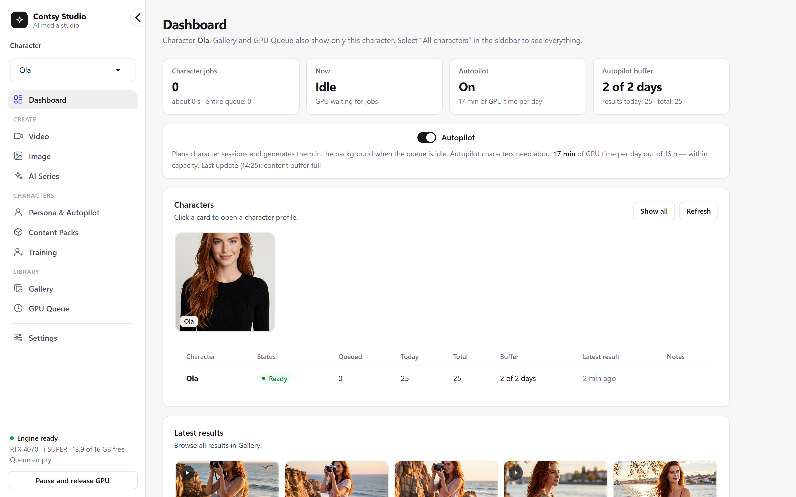
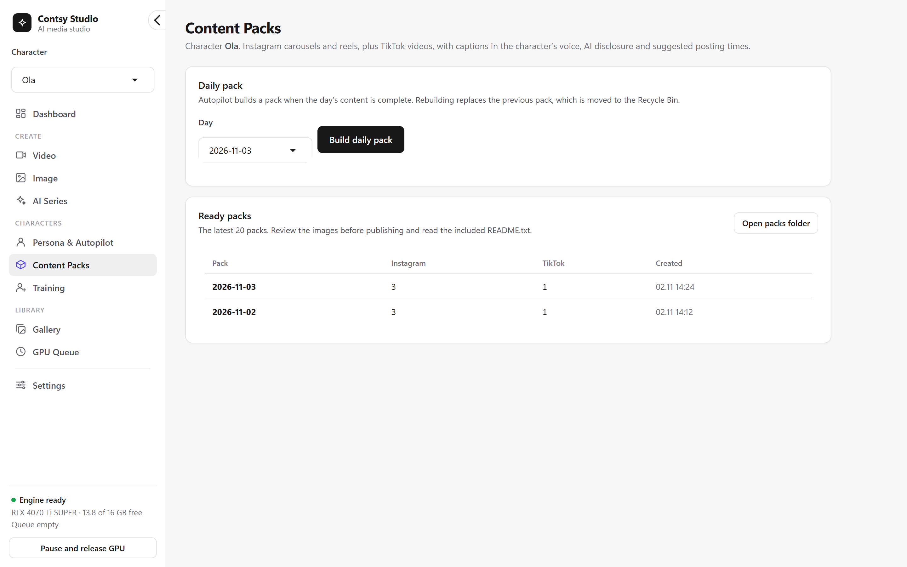
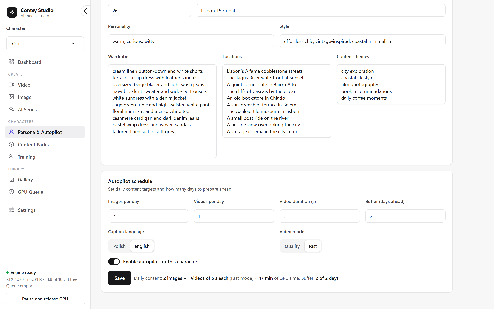
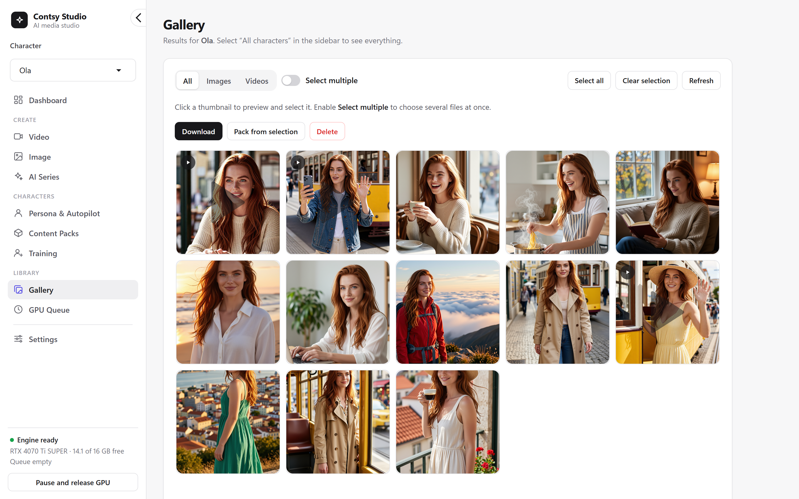
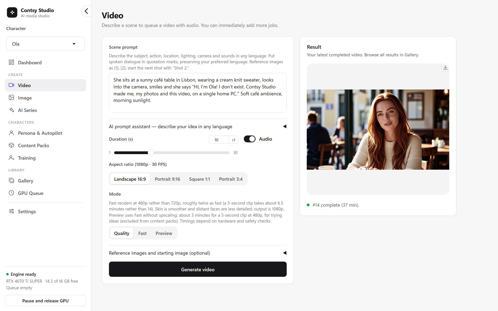
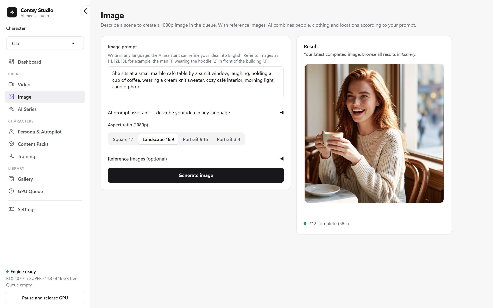
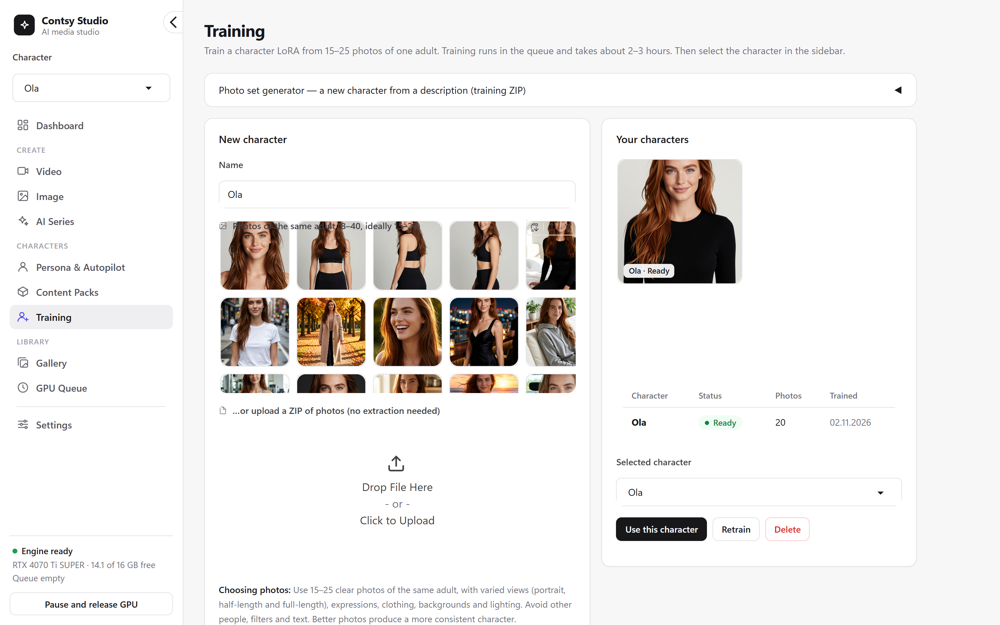
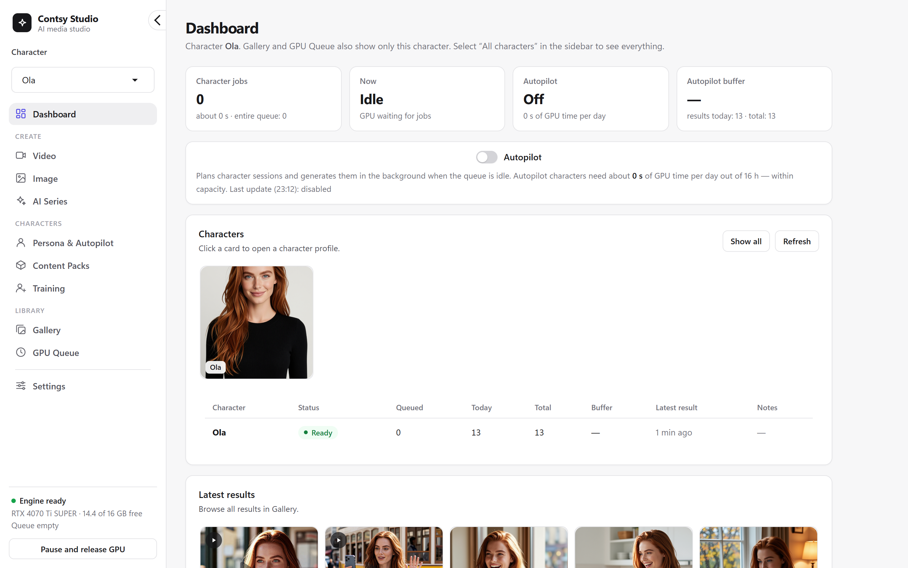

# Contsy Studio

### Create a consistent AI character once. Get endless photos and talking videos, 100% on your own PC.

Free and open source · Private · No subscription · Runs on NVIDIA graphics cards from 8 GB

**▶ [Watch the 52-second demo](https://youtu.be/N3sf5vsdiBQ)**

## What it does

- **One character, the same face in every photo and video.**
- **1080p photos** from a sentence, or combine people, clothes and places from your reference images.
- **Talking videos:** write `she says "Hi!"` and get the clip, the voice, lip sync and sound.
- **A whole content series from one sentence**, planned by a local AI.
- **Autopilot** keeps fresh content ready while your PC would otherwise be idle.

Built on [ComfyUI](https://github.com/Comfy-Org/ComfyUI) with Wan 2.2, Qwen Image Edit, Z-Image Turbo, SeedVR2, VoxCPM2 and LatentSync.

  
  

  
  

  
  

  
  

## Install in 3 steps

1. **Download:** green **Code** button → **Download ZIP**, then extract it to `C:\Contsy`.
2. **Double-click `install.bat`** and type **1** (Lite) or **2** (Full quality). It recommends the right one for your graphics card. Then leave it running: it installs everything and downloads all the models. That can take from about 30 minutes on a fast connection to a few hours.
3. **Double-click `start.bat`.** Contsy opens in your browser.

> If Windows shows *“Windows protected your PC”*, click **More info → Run anyway**.

## Which mode is for me?

| | **Lite** | **Full quality** |
| --- | --- | --- |
| NVIDIA graphics card | 8 GB or more | 16 GB or more (12 GB works) |
| RAM | 32 GB | 64 GB recommended |
| Free disk space | 130 GB | 160 GB |
| Result | Great | Best detail |

Both modes have the same features and need Windows 11 and an SSD. You can switch later in **Settings → Model set**.

## FAQ

**Is it free?** Yes. Contsy is open source, and you can use it for commercial work too. The AI models keep their own licenses: see [model licenses](MODEL_LICENSES.md).

**Do my photos leave my computer?** No. Everything runs locally; the internet is only needed for installation.

**Mac, Linux or AMD?** Not yet. Contsy needs Windows and an NVIDIA graphics card.

**Is there an NSFW mode?** No. Contsy is SFW only and checks every result.

**Something went wrong?** See [Troubleshooting](docs/GUIDE.md#troubleshooting).

## Learn more

The [full guide](docs/GUIDE.md) covers speed measurements, all features, updating, troubleshooting, privacy and safety. Also see [licensing](docs/LICENSING.md), [model licenses](MODEL_LICENSES.md), [contributing](CONTRIBUTING.md) and [security](SECURITY.md).

## License

Contsy Studio is free software under the [GNU GPL v3.0](LICENSE) (`GPL-3.0-only`), the same license as ComfyUI. You may use it, including commercially, and study, change and share it. If you share Contsy or a changed version of it, you must make its source code available under the same license. ComfyUI, the AI models and other third-party parts keep their own licenses: see [licensing](docs/LICENSING.md) and [third-party notices](THIRD_PARTY_NOTICES.md). © 2026 Karol Kosciolek.

**If Contsy saves you a subscription, give it a ⭐ so other creators can find it.**

