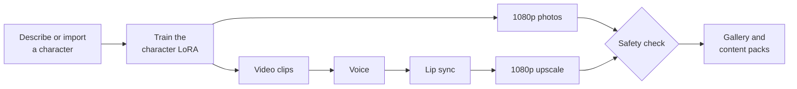

# Contsy Studio guide

Everything the [README](../README.md) leaves out: what each feature does, the two model sets in detail, measured speed, installation details, updating, troubleshooting, privacy and safety.

## Features

- **Characters.** Describe a fictional adult and let Contsy generate a training set, or import 8–40 photos (15–25 work best) of a consenting adult. Training runs in the queue.
- **Photos in 1080p.** Square, landscape, 9:16 or 3:4. With reference images, people, clothing and places are combined as you describe them.
- **Videos up to 30 seconds** in 5-second shots: text-to-video or image-to-video, in 16:9, 9:16, 1:1 or 3:4. There are three modes:
  - **Preview:** a quick 480p check.
  - **Fast:** publishable 1080p.
  - **Quality:** rendered at 720p, then upscaled to 1080p.
- **Dialogue.** Quoted lines become speech with a matching voice, lip sync and background sound.
- **AI Series.** One request, in any language, becomes a planned, editable series of photos and videos.
- **Persona & Autopilot.** Each character gets a wardrobe, locations and a content rhythm. Autopilot generates and stocks content but never posts anything.
- **Content Packs.** Reviewed media with captions, suggested posting times and AI-disclosure text for Instagram and TikTok.
- **GPU queue.** Jobs survive restarts. **Pause and release GPU** in the sidebar frees the card instantly, for example before a game.

Under the hood, these run locally:
- [ComfyUI](https://github.com/Comfy-Org/ComfyUI)
- Z-Image Turbo
- Wan 2.2
- Qwen Image Edit
- SeedVR2
- VoxCPM2
- LatentSync 1.6
- Stable Audio Open
- Qwen3.5

Every model is pinned to an exact version and verified with SHA-256.

## The two model sets

| | Lite | Full quality |
| --- | --- | --- |
| Models | The same models in lighter versions: Z-Image int8, Wan 2.2 14B Q4, Qwen Image Edit Q4, assistant Q4 | Z-Image bf16, Wan 2.2 14B Q6, Qwen Image Edit int8, assistant Q6 |
| Minimum GPU | NVIDIA RTX 30-series or newer, 8 GB of VRAM | 12 GB of VRAM (16 GB recommended) |
| System RAM | 32 GB | 64 GB recommended for video |
| Model download | 108 GB | 138 GB |

Both need Windows 11 (64-bit), an NVIDIA driver 580 or newer (CUDA 13) and an SSD; NVMe makes model loading much faster. Keep the Windows page file enabled: the engine caches models in free RAM and pages the rest from the SSD.

On GPUs under 15 GB, Contsy adapts automatically:
- the engine keeps memory free for computation;
- 1080p upscaling runs in shorter chunks;
- lip sync uses an exact low-memory mode;
- training photos are prepared on the CPU.

Character training always uses the full image model, whichever set you use.

## How fast is it?

Measured with the mandatory safety check included. *Tested PC:* RTX 4070 Ti Super 16 GB, 64 GB RAM, Core Ultra 7 265K.

| Job | Full, 16 GB | Full, 12 GB (simulated) | Lite, 8 GB + 32 GB RAM (simulated) |
| --- | --- | --- | --- |
| 1080p photo | 35 s | 35 s | 53 s |
| 1080p photo from reference images | 1.9 min | 1.7 min | 2.0 min |
| 5 s video, Preview (480p) | 4.3 min | 4.4 min | 4.6 min |
| 5 s talking video, Fast (1080p, voice and lip sync) | 12.4 min | about 12 min | about 17 min |
| 5 s video, Quality (720p → 1080p) | 14–24 min | not measured | not recommended |
| Character training (production run) | 2–3 h | same speed | same speed |
| AI Series plan | 32 s | — | 39 s |

Smaller cards were simulated on the same PC by capping how much GPU memory each component may use. The simulated columns show the cost of less memory, not of a slower chip. An RTX 3060 or 4060 computes roughly 2–3× slower, so expect correspondingly longer times. Use *Fast* for publishable 1080p video on cards under 16 GB; *Quality* is meant for 16 GB.

## Installation details

**Before you start:** you need Windows 11, an NVIDIA GeForce RTX card, an up-to-date NVIDIA driver and an internet connection.

1. **Get the files.** Download the ZIP (green **Code** button → **Download ZIP**), right-click it and choose **Extract All…** to a short path such as `C:\Contsy`. Avoid OneDrive, the Desktop and very long paths. If you use Git, `git clone` the repository instead; updating is then one command.
2. **Run `install.bat`.** It does all of this:
   - finds or installs Python 3.12, Git and FFmpeg through the Windows Package Manager (Windows may ask for permission);
   - creates a private Python environment in `venv` and installs the CUDA build of PyTorch;
   - sets up the ComfyUI engine and its extensions at pinned versions and checks that your GPU works;
   - asks for the model set and downloads every model of it.

   Each download resumes if it is interrupted and is checked against SHA-256. If anything fails, the installer says what failed and keeps everything already installed; run it again to continue. Advanced users can answer in advance with `install.bat lite`, `install.bat full` or `install.bat skip`. *skip* leaves each feature to download its models the first time you use it.
3. **Run `start.bat`.** Contsy opens `http://127.0.0.1:7860` in your browser. Running it again while Contsy is open just reopens the browser tab.

To download the other set later, run `venv\Scripts\python.exe -m app.download_models all --lite`, or the same command without `--lite` for the full set. If a model provider requires accepting its terms on Hugging Face, do that and set `HF_TOKEN` in your Windows user environment variables. Contsy never stores tokens.

**Updating.** With Git, run `git pull`, then `install.bat`. With the ZIP, extract the new ZIP over the old folder, then run `install.bat`. Your characters, results, models and settings stay where they are.

**Uninstalling.** Delete the Contsy folder. Models, characters and results all live inside it.

**Checking an installation.** Run `venv\Scripts\python.exe -m app.setup_windows --check`.

## Troubleshooting

- **The installer stopped.** Read the last lines it printed, fix the cause (for example free disk space), and run `install.bat` again. Finished downloads are kept.
- **The engine does not start.** Read `comfyui.log` in the Contsy folder. A missing NVIDIA driver or a CPU-only PyTorch produces a clear message. Running `install.bat` again repairs most problems without touching your data.
- **Out of GPU memory, or very slow.**
  - Close games and other GPU apps.
  - Switch to Lite in **Settings → Model set**, or use Fast or Preview.
  - Make a shorter clip.
  - **Pause and release GPU** in the sidebar frees the card instantly.
- **Port already in use.** Copy the `app` or `comfyui` section of `config/settings.json` into `config/settings.local.json` and change the port there.

## Privacy and safety

- **Local by design.** The app and its engine listen only on `127.0.0.1`, generation never calls a hosted API, and analytics and telemetry are switched off. Never expose ports 7860 or 8188 to a network.
- **SFW only.** Contsy refuses requests for nudity, explicit content or sexualized depictions of minors before generating anything, in many languages and spellings. Every image, and frames across every video, must also pass a local visual safety check. Anything unsafe or unverifiable goes to quarantine instead of your gallery. Automated checks can miss things, so review content before you publish it.
- **Consent.** Use fictional adults, or real adults who agreed to the use of their face, body and voice. Never impersonate real people. Training rejects photos of suspected minors.

## More questions

**Can I sell the photos and videos I make?** Contsy's license does not restrict your outputs. Each model still has its own terms, especially for commercial use: see [MODEL_LICENSES.md](../MODEL_LICENSES.md).

**How long does a character take?** Training takes about 2–3 hours of GPU time on a 16 GB card, longer on slower cards. Generating the training set from a description adds some time. Both run in the queue, so you can keep working.

**Can I offer Contsy as an online service?** The [GPL-3.0](../LICENSE) allows it, also with your own changes. Its source-code duty applies when you share copies, not when people only use Contsy over a network. Some models add their own conditions for hosted or commercial use. Contsy is built as a single-user app on your own PC, though: it has no accounts or access control, so never expose it to a network as it is (see [SECURITY.md](../SECURITY.md)). [LICENSING.md](LICENSING.md) explains the details.

**Where can I see the license and get the source code?** Open **Settings → About**. It shows the version, the license, the third-party notices and where the source code is.

**How do I run the tests?** Run `venv\Scripts\python.exe -m unittest discover -s tests -v`. See [CONTRIBUTING.md](../CONTRIBUTING.md).
